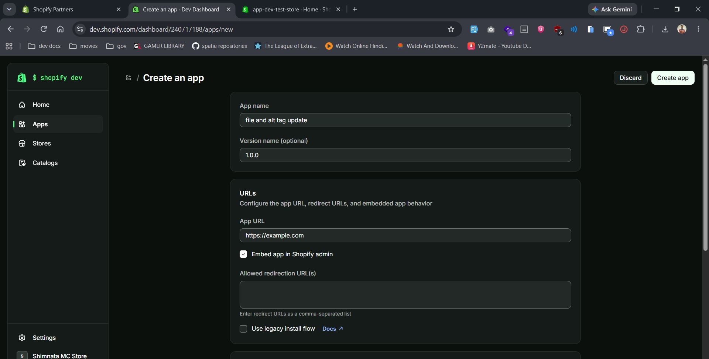
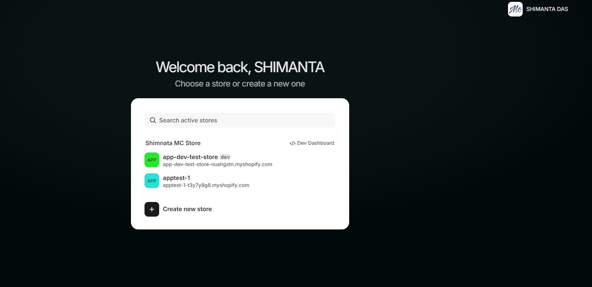

# Shopify Bulk File Name & Alt Tag Updater
Inside this module I have added 2 maun files which helps to update shopify content/media file's name and alt text.

```
fileFiles.py - helps to find files exist or not inside db
```

```
generateAccesstoken.py - helps to generate access token for store app.
```

```
shopify.py - helps to update bulk file's nameand alt text at a time.
```

## Important Note
make sure while updating the files inside shopify app stores we need to create an app with all the scopes listed in scopes.txt





